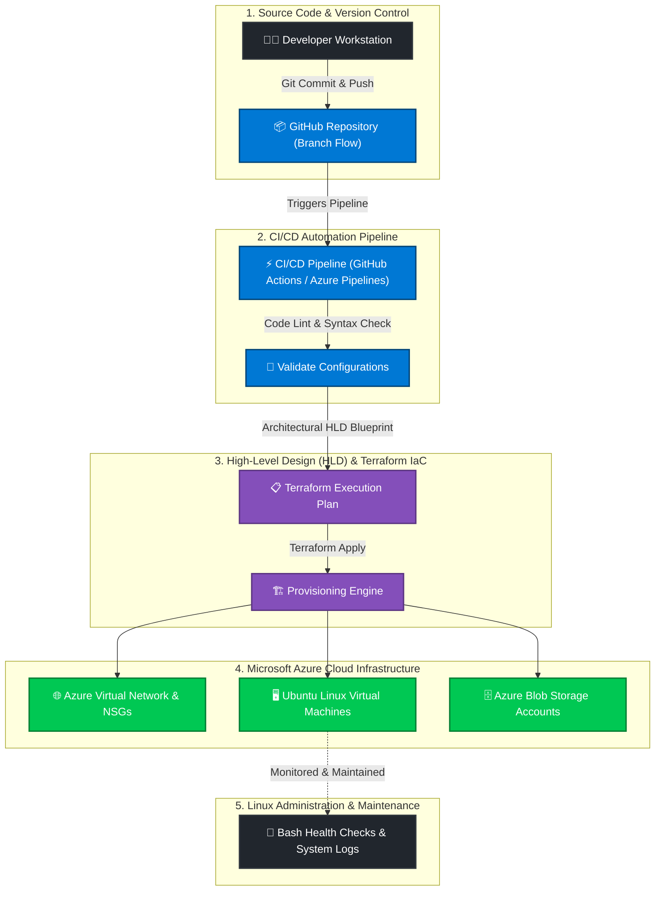

<div align="center">

  <!-- Header Banner -->
  

  <br/>

  <!-- Dynamic Typing Subtitle -->
  <a href="https://github.com/rohanchaudhary12">
    
  </a>

  <br/><br/>

  <!-- High-Impact Status Badges -->
  <p align="center">
    <a href="mailto:rohanchoudhary6867@gmail.com">
      
    </a>
    
    
    
  </p>

  <!-- Quick Action & Contact Links (Strictly Lowercase Email) -->
  <p align="center">
    <a href="mailto:rohanchoudhary6867@gmail.com">
      
    </a>
    <a href="tel:+918171379747">
      
    </a>
    <a href="https://linkedin.com/in/rohanchaudhary12" target="_blank">
      
    </a>
    <a href="https://github.com/rohanchaudhary12">
      
    </a>
    
  </p>

</div>

---

### 👨‍💻 Executive Summary

> *"I bridge the gap between development and operations through High-Level Design (HLD), repeatable Infrastructure as Code, resilient deployment automation, and robust Linux environments."*

I am an **Aspiring DevOps Engineer** and **BCA Graduate (Class of 2026)** currently working as a **DevOps Intern at DevOps Insiders**. I specialize in creating architectural **High-Level Design (HLD)** blueprints, provisioning scalable cloud workloads on **Microsoft Azure**, automating infrastructure with **Terraform (IaC)**, engineering seamless **CI/CD pipelines**, and managing production-grade **Linux server environments**.

Equipped with a strong analytical mindset, disciplined version-control workflows in **Git**, and rapid troubleshooting capability, I am actively seeking a **Full-Time DevOps Engineer role** and available as an **⚡ IMMEDIATE JOINER**.

---

### 💼 Professional Experience

```yaml
Current Role : DevOps Intern
Organization : DevOps Insiders
Duration     : June 2026 – Present
Availability : Immediate Joiner (Zero Notice Period)
Core Domains : High-Level Design (HLD) | Terraform (IaC) | Microsoft Azure | CI/CD | Linux Admin | Git
```

#### 📌 Key Responsibilities & Hands-on Deliverables:
* 📐 **High-Level Design (HLD) & Architecture:** Translating infrastructure requirements into structured High-Level Design (HLD) specifications, defining network boundaries, subnets, and security layers prior to deployment.
* 🛠️ **Infrastructure as Code (IaC):** Architecting modular, reusable **Terraform** configurations to provision cloud infrastructure predictably while eliminating manual configuration drift.
* ☁️ **Microsoft Azure Cloud:** Hands-on provisioning and management of core Azure services including **Virtual Machines, Virtual Networks (VNets), Network Security Groups (NSGs), Storage Accounts, and IAM/RBAC**.
* 🔄 **CI/CD Pipeline Engineering:** Constructing and maintaining automated continuous integration and continuous deployment pipelines for automated builds, validation, and zero-touch deployments.
* 🐧 **Linux Systems & Shell Administration:** Managing Linux environments (Ubuntu), user permissions, systemd services, SSH hardening, package administration, and writing **Bash automation scripts** for day-to-day operations.
* 🔀 **Version Control Best Practices:** Enforcing clean Git branching strategies, pull request workflows, and infrastructure versioning across collaborative DevOps tasks.

---

### 🛠️ Technical Arsenal

<div align="center">

#### ☁️ Cloud Architecture & High-Level Design (HLD)
<p align="center">
  
  
  
  
  
  
</p>

#### 🏗️ Infrastructure as Code (IaC) & Configuration
<p align="center">
  
  
  
  
</p>

#### 🔄 CI/CD & Deployment Workflows
<p align="center">
  
  
  
  
</p>

#### 🐧 Operating Systems & Scripting
<p align="center">
  
  
  
  
  
</p>

#### 🔀 Version Control & Collaboration
<p align="center">
  
  
  
  
</p>

</div>

---

### 🎯 Core DevOps Focus Areas

| Domain | What I Practice & Deliver |
| :--- | :--- |
| **High-Level Design (HLD)** | Designing clear cloud architecture blueprints, VNet topologies, subnet division, NSG rules, and resource grouping before code execution. |
| **Infrastructure as Code** | Writing declarative Terraform scripts (`.tf`), managing state files, modularizing infrastructure code for reusable multi-environment deployment (Dev/Staging/Prod). |
| **Cloud Infrastructure (Azure)** | Creating secure Azure VNets, subnets, configuring NSG security rules, provisioning Virtual Machines, managing Blob Storage & role-based access control (RBAC). |
| **CI/CD Pipeline Automation** | Translating deployment steps into robust YAML pipeline workflows, configuring triggers, secrets management, automated testing, and multi-stage release delivery. |
| **Linux Administration** | CLI troubleshooting, process monitoring (`top`, `ps`, `htop`), disk space analysis (`df`, `du`), systemd service management, permissions (`chmod`, `chown`), and automated cron jobs. |
| **Version Control Architecture** | Feature branching workflows, semantic commit conventions, resolving merge conflicts, and automated GitHub PR checks. |

---

### 🏗️ Practical DevOps Architectures & Workflows



---

### 💡 Why Hire Me? (Value for Your Team)

<table>
  <tr>
    <td width="50%">
      <h4 align="center">⚡ Immediate Joiner</h4>
      <p>I have zero notice period and am ready to onboard immediately to start contributing to your sprints from Day 1.</p>
    </td>
    <td width="50%">
      <h4 align="center">📐 HLD & IaC-First Mindset</h4>
      <p>Focused on High-Level Design (HLD) planning and automating everything through Terraform so your environments are immutable, predictable, and drift-free.</p>
    </td>
  </tr>
  <tr>
    <td width="50%">
      <h4 align="center">🐧 Strong Linux & CLI Backbone</h4>
      <p>Comfortable on remote headless servers, investigating logs, writing custom shell automations, and debugging production issues.</p>
    </td>
    <td width="50%">
      <h4 align="center">📈 High Growth & Quick Adapter</h4>
      <p>Proven track record of rapidly learning tools, diving deep into technical documentation, and translating business needs into automated pipelines.</p>
    </td>
  </tr>
</table>

---

### 🌟 Professional Strengths

* 🔍 **Problem Solving:** Identifies practical issues, understands underlying root causes, and implements clean, lasting solutions.
* 🗣️ **Clear Communication:** Articulates technical concepts effectively across cross-functional teams and documentation.
* 🤝 **Collaborative Team Player:** Values shared learning, peer code reviews, and constructive feedback loops.
* ⏱️ **Time Management:** Organizes learning and project milestones with discipline to consistently beat deadlines.
* 📚 **Continuous Learner:** Self-driven learner constantly sharpening cloud, automation, and DevOps competencies.

---

### 🎓 Education

| Qualification / Degree | Institution | Board / University | Status |
| :--- | :--- | :--- | :--- |
| **Bachelor of Computer Applications (BCA)** | Teerthanker Mahaveer University | TMU | Completed (Class of 2026) |
| **Class 12th (Senior Secondary)** | Gyandeep Public Inter College | State Board | Completed |
| **Class 10th (Secondary)** | Gyandeep Public Inter College | State Board | Completed |

---

### 📊 GitHub Activity & Analytics

<div align="center">
  <table border="0">
    <tr>
      <td>
        
      </td>
      <td>
        
      </td>
    </tr>
  </table>

  <br/>

  
</div>

---

### 📬 Let's Connect & Build Scalable Systems!

Are you looking for an energetic, disciplined **DevOps Engineer** who is ready to take ownership of cloud infrastructure and deployment pipelines? **I'm ready to interview and join your team immediately!**

<div align="center">

  <p>
    📧 <strong>Email:</strong> <a href="mailto:rohanchoudhary6867@gmail.com">rohanchoudhary6867@gmail.com</a> &bull;
    📱 <strong>Phone / WhatsApp:</strong> <a href="tel:+918171379747">+91-8171379747</a>
  </p>

  <p align="center">
    <a href="mailto:rohanchoudhary6867@gmail.com">
      
    </a>
    &nbsp;
    <a href="tel:+918171379747">
      
    </a>
    &nbsp;
    <a href="https://linkedin.com/in/rohanchaudhary12" target="_blank">
      
    </a>
    &nbsp;
    <a href="https://github.com/rohanchaudhary12">
      
    </a>
  </p>

  <br/>

  <!-- Footer Banner -->
  

  <p align="center">
    <i>Designed with passion for DevOps & Cloud Automation &bull; &copy; 2026 Rohan Chaudhary</i>
  </p>

</div>
